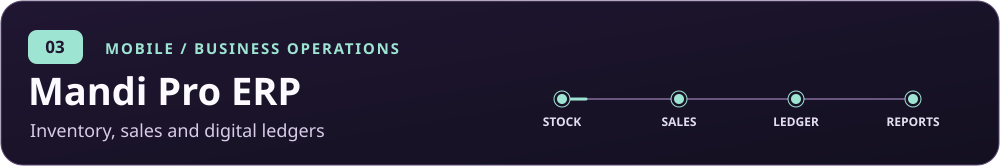

  <strong><a href="#selected-work">Selected work</a></strong> &nbsp;·&nbsp;
  <a href="#technical-focus">Technical focus</a> &nbsp;·&nbsp;
  <a href="https://ir786106.github.io/Muhammad_Irfan_Waseem_Portfolio/">Portfolio</a> &nbsp;·&nbsp;
  <a href="https://www.linkedin.com/in/muhammad-irfan-waseem-48226b297/">LinkedIn</a>

I build mobile apps and backend services for delivery, retail operations, and AI-assisted learning. I study Computer Science at **COMSATS University Islamabad, Sahiwal Campus**, and write about cybersecurity at [VeilGuard Security Journal](https://veilguardsecjournal.blogspot.com/).

## Selected work

**[Food Fight](https://github.com/Ir786106/food-fight-app)** is a multi-branch ordering and delivery app with customer, kitchen, and rider experiences. It includes server-validated COD checkout, rider dispatch, and cash settlement. 
`Flutter` · `Dart` · `Firebase` &nbsp; | &nbsp; [Download the signed Android APK](https://github.com/Ir786106/food-fight-app/releases/latest)

**[InterviewMate AI Pro](https://github.com/Ir786106/ai-interview-pro)** supports AI-assisted interview practice across written, technical, HR, audio, and video stages. 
`React` · `Node.js` · `FastAPI` · `Gemini` · `Groq` · `MediaPipe`

**[Mandi Pro ERP](https://github.com/Ir786106/mandi-pro-erp)** digitizes stock, purchases, sales, invoices, and ledgers for grain-market businesses. 
`Flutter` · `Firebase` · `Cloud Firestore`

**More work** &nbsp; [Itthad Food Industries](https://github.com/Ir786106/itthad_food_industries) · [Saqib Shop POS](https://github.com/Ir786106/saqib_shop) · [All repositories](https://github.com/Ir786106?tab=repositories)

## Technical focus

- **Mobile** · Flutter, Dart, React Native, Expo
- **Web, APIs, and data** · React, Node.js, Express, FastAPI, Python, Firebase, Supabase, MongoDB, MySQL
- **Applied AI and security** · Gemini API, Groq, OpenRouter, MediaPipe, Wireshark, Burp Suite

## Experience

| Role | Organization | Period |
| --- | --- | --- |
| Android App Developer Intern | ARCH Technology | April–May 2026 |
| Freelance Graphic Designer | Independent | 2021–2024 |
| BS Computer Science | COMSATS University Islamabad, Sahiwal Campus | 2023–present |

## Activity and contact

  <a href="mailto:muhammadirfan.infosec@gmail.com">Email</a> &nbsp;·&nbsp;
  <a href="https://www.linkedin.com/in/muhammad-irfan-waseem-48226b297/">LinkedIn</a> &nbsp;·&nbsp;
  <a href="https://veilguardsecjournal.blogspot.com/">Security journal</a>

