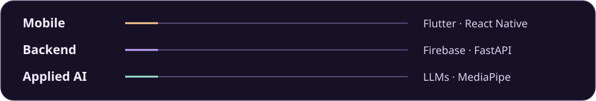

  

<h1 align="center">Muhammad Irfan Waseem</h1>

  <a href="https://ir786106.github.io/Muhammad_Irfan_Waseem_Portfolio/">Portfolio</a> ·
  <a href="https://www.linkedin.com/in/muhammad-irfan-waseem-48226b297/">LinkedIn</a> ·
  <a href="https://veilguardsecjournal.blogspot.com/">Security journal</a> ·
  <a href="mailto:muhammadirfan.infosec@gmail.com">Email</a>

## About

I build cross-platform mobile apps and the APIs behind them. My work includes food delivery, inventory and retail operations, and AI-assisted interview practice. I study Computer Science at COMSATS University Islamabad, Sahiwal Campus, and write about cybersecurity at VeilGuard Security Journal.

## Selected projects

| Project | What it does | Stack |
| --- | --- | --- |
| **[Food Fight](https://github.com/Ir786106/food-fight-app)** | Multi-branch food ordering with customer, kitchen, and rider workflows. Includes COD checkout, rider dispatch, cash settlement, and a [signed Android release](https://github.com/Ir786106/food-fight-app/releases/latest). | Flutter, Dart, Firebase |
| **[InterviewMate AI Pro](https://github.com/Ir786106/ai-interview-pro)** | AI-assisted interview preparation covering written, technical, HR, audio, and video practice. | MERN, FastAPI, Gemini, Groq, MediaPipe |
| **[Mandi Pro ERP](https://github.com/Ir786106/mandi-pro-erp)** | Digital sales, purchases, stock, ledgers, invoices, and reporting for grain-market operations. | Flutter, Firebase |
| **[Itthad Food Industries](https://github.com/Ir786106/itthad_food_industries)** | Inventory and order tracking for food-industry operations. | Flutter, Firebase |
| **[Saqib Shop](https://github.com/Ir786106/saqib_shop)** | Point of sale and a digital ledger for retail stock and transactions. | Flutter, Dart |

## Development focus

| Area | Tools |
| --- | --- |
| Mobile | Flutter, Dart, React Native, Expo |
| Web and APIs | React, Node.js, Express, FastAPI, Python |
| Data and services | Firebase, Cloud Firestore, Supabase, MongoDB, MySQL |
| AI and security | Gemini API, Groq, OpenRouter, MediaPipe, Wireshark, Burp Suite |

## Experience and education

- **Android App Developer Intern · ARCH Technology** · April–May 2026
- **Freelance Graphic Designer** · 2021–2024
- **BS Computer Science · COMSATS University Islamabad, Sahiwal Campus** · 2023–present

## GitHub activity

[Browse all repositories](https://github.com/Ir786106?tab=repositories) · [Read VeilGuard Security Journal](https://veilguardsecjournal.blogspot.com/) · [Connect on LinkedIn](https://www.linkedin.com/in/muhammad-irfan-waseem-48226b297/)
