I build Flutter apps for delivery and business operations, and the backend services they depend on. Freelance developer since January 2025 · BS Computer Science, COMSATS University Islamabad, Sahiwal Campus · Class of 2027.

**[Portfolio](https://ir786106.github.io/Muhammad_Irfan_Waseem_Portfolio/)** · [VeilGuard Journal](https://veilguardsecjournal.blogspot.com/) · [LinkedIn](https://www.linkedin.com/in/muhammad-irfan-waseem-48226b297/) · [Email](mailto:muhammadirfan.infosec@gmail.com)

## Selected work

### Food Fight

A multi-branch Flutter delivery platform for customers, kitchen staff, and riders. The backend validates Cash on Delivery quotes, manages rider dispatch, and records cash handover after delivery.

**Flutter · Firebase · Cloud Functions** 
[View source](https://github.com/Ir786106/food-fight-app) · **[Download signed Android APK](https://github.com/Ir786106/food-fight-app/releases/latest)**

- **[Mandi Pro ERP](https://github.com/Ir786106/mandi-pro-erp)** · Inventory, purchases, sales, and ledgers for grain-market businesses. `Flutter` · `Firebase` · `GetX`
- **[TeamSync](https://github.com/Ir786106/teamsync-saas)** · Multi-tenant workspaces, task ownership, and progress reporting. `MERN` · `TypeScript`
- **[HireReady PK](https://github.com/Ir786106/ai-interview-pro)** · AI-assisted interview and aptitude practice for Pakistani tech candidates. `React` · `FastAPI` · `Gemini`

## Technical focus

**App development** · Flutter, Dart, GetX, React Native, Expo 
**Software engineering** · React, TypeScript, Node.js, Express, Firebase, Supabase, MongoDB 
**Cybersecurity practice** · Kali Linux, Wireshark, Burp Suite

## Cybersecurity writing

I publish practical security notes at **[VeilGuard Security Journal](https://veilguardsecjournal.blogspot.com/)**, with recent posts below.

<!-- BLOG:START -->
<ul>
<li><a href="https://veilguardsecjournal.blogspot.com/2026/09/networking-basics-types-topologies-guide.html">Computer Networking Basics: Types, Working, and Topologies Explained</a></li>
<li><a href="https://veilguardsecjournal.blogspot.com/2026/06/the-blueprint-of-cyber-defense.html">The Blueprint of Cyber Defense: Mastering CISSP Domain 1 &amp; Risk Management</a></li>
<li><a href="https://veilguardsecjournal.blogspot.com/2026/06/my-cybersecurity-journey.html">My Cybersecurity Journey: From Mobile App Development to Digital Defense</a></li>
</ul>
<!-- BLOG:END -->

## GitHub activity

<a href="https://github.com/Ir786106#contributions">
  <picture>
    <source media="(prefers-color-scheme: dark)" srcset="assets/profile/activity-dark.svg">
    
  </picture>
</a>

  
Contribution streaks and primary languages

  <picture>
    <source media="(prefers-color-scheme: dark)" srcset="assets/profile/stats-dark.svg">
    
  </picture>

## Work with me

I’m open to Flutter freelance projects, software development internships, and collaboration. [Email me](mailto:muhammadirfan.infosec@gmail.com) with a short description of your project.

[Portfolio](https://ir786106.github.io/Muhammad_Irfan_Waseem_Portfolio/) · [LinkedIn](https://www.linkedin.com/in/muhammad-irfan-waseem-48226b297/) · [X](https://x.com/Irfan_CyberSec)
