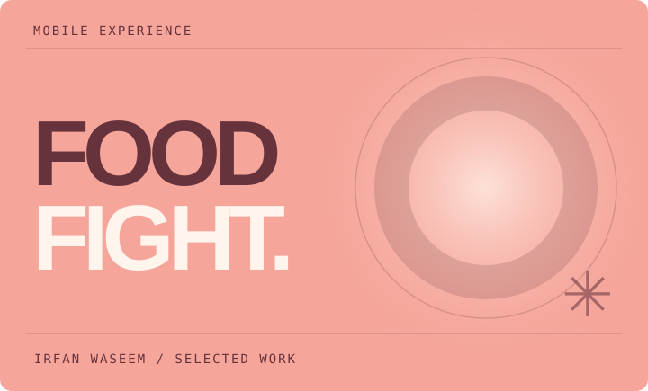
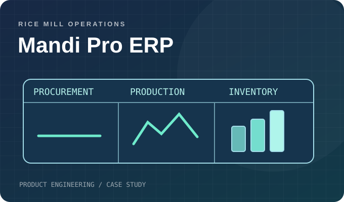
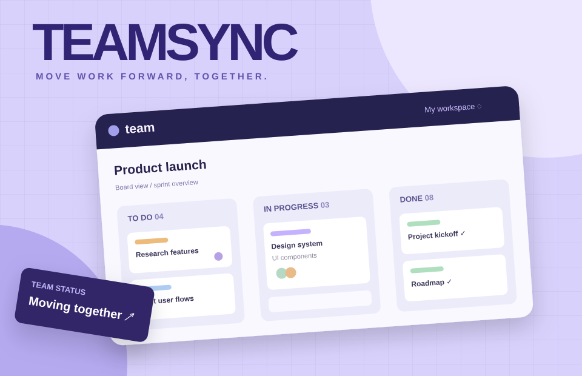
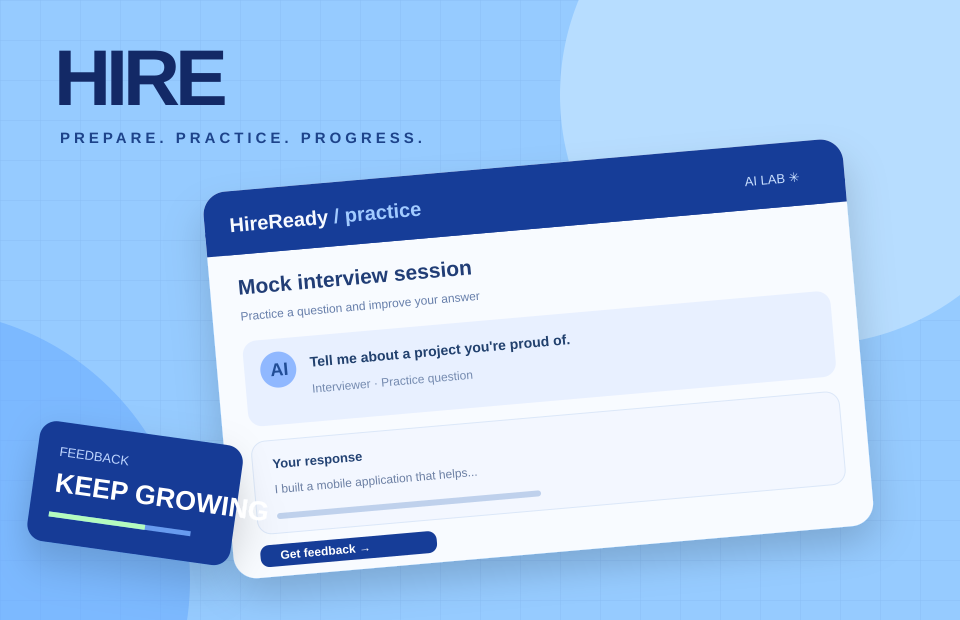

  

  <h3>Building digital products that solve real operational problems.</h3>
  
Flutter apps · Full-stack engineering · Practical security

  

    <a href="https://ir786106.github.io/Muhammad_Irfan_Waseem_Portfolio/">Portfolio</a> &nbsp;·&nbsp;
    <a href="https://github.com/Ir786106?tab=repositories">Repositories</a> &nbsp;·&nbsp;
    <a href="https://veilguardsecjournal.blogspot.com/">Security journal</a> &nbsp;·&nbsp;
    <a href="mailto:muhammadirfan.infosec@gmail.com">Email</a> &nbsp;·&nbsp;
    <a href="https://www.linkedin.com/in/muhammad-irfan-waseem-48226b297/">LinkedIn</a>
  

  <a href="#featured-projects">Selected work</a> &nbsp; • &nbsp;
  <a href="#what-i-work-with">Tech stack</a> &nbsp; • &nbsp;
  <a href="#github-activity">Activity</a> &nbsp; • &nbsp;
  <a href="#lets-connect">Contact</a>

## About me

I'm a computer science student at **COMSATS University Islamabad, Sahiwal Campus** (class of 2027) and a developer focused on products people actually use: business workflows, delivery operations, secure backends, and clean mobile interfaces.

- **Build:** Flutter / Dart, React, TypeScript, and backend APIs.
- **Think:** role-based access, safe data handling, operational clarity, and reliable user journeys.
- **Explore:** application security and practical cybersecurity research.
- **Collaborate:** open to development work, internships, and interesting product teams.

## Featured projects

<table>
  <tr>
    <td width="50%" valign="top">
      
      <h3>Food Fight</h3>
      
Multi-role food delivery app covering customer orders, restaurant operations, rider delivery, and Cash on Delivery workflows.

      
<code>Flutter</code> <code>Firebase</code> <code>Node.js</code>

      
<a href="https://github.com/Ir786106/food-fight-app">View repository</a> · <a href="https://github.com/Ir786106/food-fight-app/releases">Check releases</a>

    </td>
    <td width="50%" valign="top">
      
      <h3>Mandi Pro ERP</h3>
      
Business software for stock, purchasing, sales, and ledgers in grain-market workflows.

      
<code>Flutter</code> <code>Firebase</code> <code>GetX</code>

      
<a href="https://github.com/Ir786106/mandi-pro-erp">View repository</a>

    </td>
  </tr>
  <tr>
    <td width="50%" valign="top">
      
      <h3>TeamSync</h3>
      
Workspace and task collaboration with team roles, ownership, and progress tracking.

      
<code>React</code> <code>TypeScript</code> <code>Node.js</code>

      
<a href="https://github.com/Ir786106/teamsync-saas">View repository</a>

    </td>
    <td width="50%" valign="top">
      
      <h3>HireReady PK</h3>
      
Interview and aptitude practice built around AI-assisted feedback and local career preparation.

      
<code>React</code> <code>FastAPI</code> <code>Gemini</code>

      
<a href="https://github.com/Ir786106/ai-interview-pro">View repository</a>

    </td>
  </tr>
</table>

Project graphics are original conceptual illustrations, not screenshots of running applications. Links point to the source repositories; a downloadable APK is not claimed unless a release is published.

## What I work with

| Area | Tools and technologies |
| :--- | :--- |
| **Mobile development** | Flutter, Dart, Provider, GetX, React Native |
| **Web applications** | React, TypeScript, HTML, CSS, JavaScript |
| **Backend & cloud** | Node.js, Express, FastAPI, Firebase, Supabase |
| **Data & tooling** | Firestore, MongoDB, Git, GitHub Actions |
| **Security practice** | Kali Linux, Wireshark, Burp Suite |

## Cybersecurity writing

I write about networking, security fundamentals, and the path from software engineering to practical digital defense at **[VeilGuard Security Journal](https://veilguardsecjournal.blogspot.com/)**.

<!-- BLOG:START -->
<ul>
<li><a href="https://veilguardsecjournal.blogspot.com/2026/09/networking-basics-types-topologies-guide.html">Computer Networking Basics: Types, Working, and Topologies Explained</a></li>
<li><a href="https://veilguardsecjournal.blogspot.com/2026/06/the-blueprint-of-cyber-defense.html">The Blueprint of Cyber Defense: Mastering CISSP Domain 1 &amp; Risk Management</a></li>
<li><a href="https://veilguardsecjournal.blogspot.com/2026/06/my-cybersecurity-journey.html">My Cybersecurity Journey: From Mobile App Development to Digital Defense</a></li>
</ul>
<!-- BLOG:END -->

## GitHub activity

<a href="https://github.com/Ir786106#contributions">
  <picture>
    <source media="(prefers-color-scheme: dark)" srcset="assets/profile/activity-dark.svg" />
    
  </picture>
</a>

  
<b>Expand: repository statistics, streaks, and languages</b>

   
  <picture>
    <source media="(prefers-color-scheme: dark)" srcset="assets/profile/stats-dark.svg" />
    
  </picture>
  
Automatically generated from GitHub public data; statistics are a point-in-time snapshot, not a claim about private work.

## Let's connect

I'm interested in Flutter and full-stack projects, internships, and collaborations where I can contribute to a real product. If that sounds relevant, send a project summary by **[email](mailto:muhammadirfan.infosec@gmail.com?subject=Let's%20build%20something)** or connect on **[LinkedIn](https://www.linkedin.com/in/muhammad-irfan-waseem-48226b297/)**.

  
<a href="https://ir786106.github.io/Muhammad_Irfan_Waseem_Portfolio/">Portfolio website</a> · <a href="https://veilguardsecjournal.blogspot.com/">Security articles</a> · <a href="https://github.com/Ir786106">GitHub</a>

  Designed with readable content, lightweight animated SVGs and no external image-hosting dependency.

