  
  
  <h2>Software development, with intention.</h2>
  
Flutter apps · Full-stack platforms · Security-aware engineering

  

    <a href="https://ir786106.github.io/Ir786106/"><b>↗ Explore portfolio</b></a>
    &nbsp; · &nbsp;
    <a href="https://github.com/Ir786106?tab=repositories">All repositories</a>
    &nbsp; · &nbsp;
    <a href="https://veilguardsecjournal.blogspot.com/">Security writing</a>
    &nbsp; · &nbsp;
    <a href="mailto:muhammadirfan.infosec@gmail.com">Email</a>
    &nbsp; · &nbsp;
    <a href="https://www.linkedin.com/in/muhammad-irfan-waseem-48226b297/">LinkedIn</a>
  

### `01` / HELLO, I'M IRFAN

I'm **Muhammad Irfan Waseem**, a BS Computer Science student at COMSATS University Islamabad — Sahiwal Campus (class of 2027), based in Pakistan.

I enjoy building **usable mobile products, operational software, and clean full-stack experiences**. I'm interested in the small details that make complex systems feel straightforward, and I'm continually learning more about practical application security.

### `02` / SELECTED PROJECTS

<table>
<tr>
<td width="50%" valign="top">

<h3>01. Food Fight</h3>

Multi-role Flutter food delivery product covering ordering, restaurant operations, rider workflows, and Cash on Delivery.

<code>Flutter</code> <code>Firebase</code> <code>Node.js</code>

<a href="https://github.com/Ir786106/food-fight-app"><b>View repository ↗</b></a>
</td>
<td width="50%" valign="top">

<h3>02. Mandi Pro ERP</h3>

Grain-market workflows for inventory, purchasing, sales, and ledger management.

<code>Flutter</code> <code>Firebase</code> <code>GetX</code>

<a href="https://github.com/Ir786106/mandi-pro-erp"><b>View repository ↗</b></a>
</td>
</tr>
<tr>
<td width="50%" valign="top">

<h3>03. TeamSync</h3>

Collaboration workspace exploring task ownership, roles, and progress visibility.

<code>React</code> <code>TypeScript</code> <code>Node.js</code>

<a href="https://github.com/Ir786106/teamsync-saas"><b>View repository ↗</b></a>
</td>
<td width="50%" valign="top">

<h3>04. HireReady PK</h3>

AI-assisted mock-interview and aptitude-practice concepts for career preparation.

<code>React</code> <code>FastAPI</code> <code>Gemini</code>

<a href="https://github.com/Ir786106/ai-interview-pro"><b>View repository ↗</b></a>
</td>
</tr>
</table>

Artwork is illustrative, not a screenshot of a production application. Check each repository for actual implementation and release status.

### `03` / MY TOOLKIT

| Focus | Technologies |
|:--|:--|
| **Mobile** | Flutter, Dart, Provider, GetX |
| **Frontend** | React, TypeScript, JavaScript, HTML, CSS |
| **Backend / Data** | Node.js, Firebase, Supabase, FastAPI |
| **Security learning** | Wireshark, Burp Suite, Kali Linux |

### `04` / WRITING & LEARNING

I share notes about networking, security fundamentals, and the crossover between software engineering and digital defense on the **[VeilGuard Security Journal](https://veilguardsecjournal.blogspot.com/)**.

<!-- BLOG:START -->
<ul>
<li><a href="https://veilguardsecjournal.blogspot.com/2026/09/networking-basics-types-topologies-guide.html">Computer Networking Basics: Types, Working, and Topologies Explained</a></li>
<li><a href="https://veilguardsecjournal.blogspot.com/2026/06/the-blueprint-of-cyber-defense.html">The Blueprint of Cyber Defense: Mastering CISSP Domain 1 &amp; Risk Management</a></li>
<li><a href="https://veilguardsecjournal.blogspot.com/2026/06/my-cybersecurity-journey.html">My Cybersecurity Journey: From Mobile App Development to Digital Defense</a></li>
</ul>
<!-- BLOG:END -->

### `05` / GITHUB ACTIVITY

<a href="https://github.com/Ir786106#contributions">
  <picture>
    <source media="(prefers-color-scheme: dark)" srcset="assets/profile/activity-dark.svg" />
    
  </picture>
</a>

<b>Explore public repository statistics</b>

 
<picture>
  <source media="(prefers-color-scheme: dark)" srcset="assets/profile/stats-dark.svg" />
  
</picture>

<small>Snapshots are generated from public data by the retained GitHub Actions workflow.</small>

  <h2>Have something in mind?</h2>
  
For mobile apps, full-stack development, internships or collaboration, I'd be glad to hear about the problem you're trying to solve.

  
<b><a href="mailto:muhammadirfan.infosec@gmail.com?subject=Project%20inquiry">Start a conversation ↗</a></b>

  
<a href="https://ir786106.github.io/Ir786106/">Portfolio website</a> · <a href="https://github.com/Ir786106">GitHub</a> · <a href="https://veilguardsecjournal.blogspot.com/">Journal</a>

